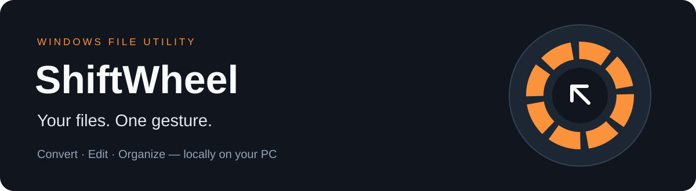
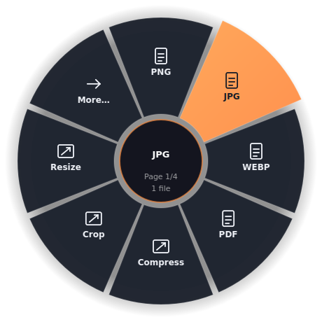

<p align="center"></p>

<p align="center">
<a href="https://github.com/CovalschiPaul/ShiftWheel/actions/workflows/build-windows.yml"></a>


</p>

# ShiftWheel

**Hold Shift. Drag a file. Choose what happens next.**

ShiftWheel is a Windows tray app that puts file conversion and everyday edits in a radial menu beside your cursor. Work with images, PDFs, Office documents, tables, audio and video without opening a different app for every task.

Conversions run locally. No account, cloud upload or AI subscription is required. Originals are kept, and results use new filenames.

<p align="center"></p>

*Interface preview rendered from the app; Windows Explorer interaction still needs desktop acceptance testing.*

## Try the preview

[**Download a Windows build →**](https://github.com/CovalschiPaul/ShiftWheel/actions/workflows/build-windows.yml)

Open a successful workflow run and download **ShiftWheel-Windows-…** under **Artifacts** (GitHub sign-in required). Extract the ZIP and run `ShiftWheelSetup-3.5.exe`. Artifacts expire after 14 days; if none remain, build from source using the [installer guide](INSTALLER_README.md).

The installer includes Python and the app libraries. It installs for your Windows user, with optional desktop and startup shortcuts. **This is an unsigned preview, not a stable release.** Clean installation, upgrades, uninstall and Explorer integration still need hands-on Windows checks.

Verified Windows build: [run #4](https://github.com/CovalschiPaul/ShiftWheel/actions/runs/41797363438), **157 tests passed / 9 skipped**, packaged conversion smoke checks passed. See [validation details](VALIDATION.md).

## A small menu with useful tools

| Work with | What you can do |
|---|---|
| Images | Convert PNG/JPG/WebP/BMP/TIFF/PDF; resize, crop, rotate, flip, watermark and remove metadata |
| PDFs | Merge, extract pages, render images, rotate, compress, extract text and OCR |
| Office files | Convert documents, presentations and spreadsheets; export pages or slides as images |
| Tables | Convert CSV/TSV/flat JSON/XLSX and export every worksheet |
| Video & audio | Convert, trim, compress, change video speed, extract audio and create GIFs |
| Everyday files | Create ZIPs, make renamed copies, copy paths and open the containing folder |

The menu shows up to eight wedges at a time. Hover over **More** to reach the next page. Jobs run in the background and report failures rather than silently claiming success.

## Three steps

1. Launch **ShiftWheel** from Start and find its orange tray icon.
2. Hold **Shift** while dragging a file in Explorer. Drop it on an action.
3. Collect the output beside the original, or enable **Save into a 'Converted' folder** in the tray menu.

Prefer a file picker? Right-click the tray icon and choose **Convert files… (no dragging)**. Press **Esc** to dismiss the wheel.

[Read the user guide →](docs/USER_GUIDE.md)

## Optional conversion engines

| Feature | Separate installation |
|---|---|
| Office rendering and format conversion | LibreOffice |
| Audio and video | FFmpeg |
| OCR | Tesseract and the desired language data |

These executables are **not bundled**. Image, PDF and basic table operations work with the included libraries. HEIF and OCR Python integrations are included in the installer; source users can run `install_optional.bat`.

See the [complete format matrix and fidelity limits](SUPPORTED_FORMATS.md). Supported conversion pairs have boundaries: PDF-to-editable Office reconstruction is not included, OCR extracts plain text, and static slide exports do not preserve animation.

## Run or build from source

On Windows with Python installed:

```bat
git clone https://github.com/CovalschiPaul/ShiftWheel.git
cd ShiftWheel
setup_shiftwheel.bat
start_shiftwheel.bat
```

For a packaged installer, use [BuildInstaller.cmd and the build guide](INSTALLER_README.md). Development and tests are described in [CONTRIBUTING.md](CONTRIBUTING.md).

## Project information

- [User guide & troubleshooting](docs/USER_GUIDE.md)
- [Supported formats & limitations](SUPPORTED_FORMATS.md)
- [Validation & remaining Windows checks](VALIDATION.md)
- [Changelog](CHANGELOG.md) · [Roadmap](ROADMAP.md)
- [Report a bug or suggest a feature](https://github.com/CovalschiPaul/ShiftWheel/issues/new/choose)
- [Security reporting](SECURITY.md) · [Licensing status](LICENSING.md)

Created by [Paul Covalschi](https://github.com/CovalschiPaul). Public source preview; no open-source license has been selected.
